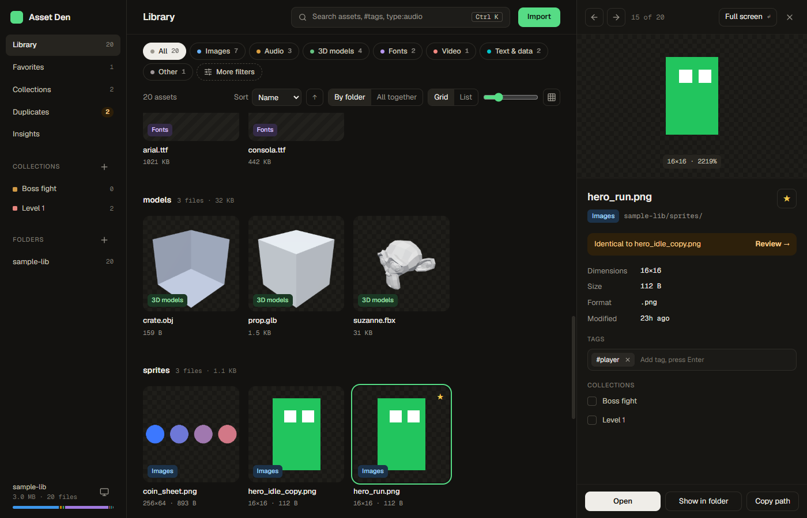
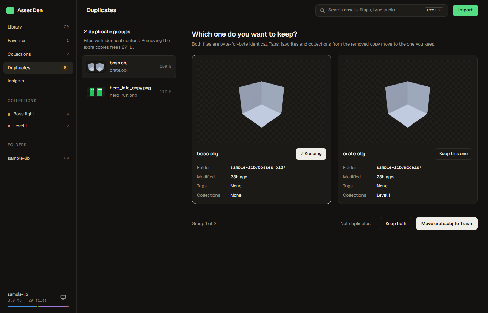
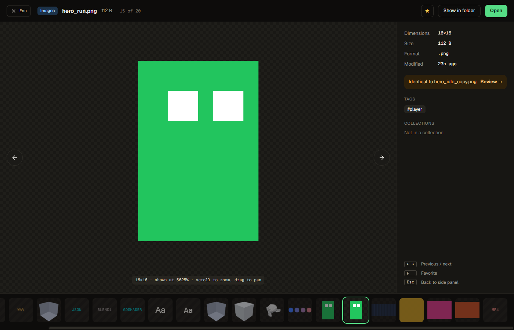

# Asset Den

A desktop asset browser for game developers on Windows, macOS and Linux. Point it at your asset folders and it
indexes every sprite, sound, model, font, video and data file so you can find, preview, tag and drag them into your
engine.



**Your files are left alone.** Tags, favorites and collections live in the app's own database, and removing a folder
from the library only forgets it. The one exception is on the Duplicates page: when you choose to, Asset Den moves the
extra copies of a file to your system's Trash (restorable there), after asking and after checking that they are still
byte-for-byte identical. "Copy to folder…" only ever creates new files.

## Features

- **Library**: import one or more folders. Assets appear while a folder is still scanning, and a live watcher picks up
  added, renamed and deleted files (renames keep their tags). Engine sidecars (`.meta`, `.import`, `.uid`), hidden
  folders and `node_modules` are skipped.
- **Folders**: an expandable folder tree in the sidebar with file counts, and a breadcrumb in the header whose carets
  jump to any subfolder or a recent folder. Subfolder chips drill down, <kbd>Alt+↑</kbd> goes to the parent, and
  **Include subfolders** switches between a folder's own files and everything below it.
- **Browse**: a grid or list grouped by folder (or all together), type chips, sorting and a thumbnail-size slider.
  **More filters** narrows by extension, image size, file size, date and tags.
- **Search** (<kbd>Ctrl/⌘ K</kbd> or <kbd>/</kbd>): one box for assets, folders and actions, with `type:audio`,
  `in:sprites`, `#player` and `size:>1mb`. Its first result applies the search to the grid.
- **Side panel** (<kbd>Space</kbd>) and **full screen** (<kbd>Enter</kbd>) previews:
  - images: zoom and pan, pixel-art scaling, transparency checkerboard (PNG, JPG, GIF, WebP, BMP, SVG, and
    TGA/PSD/TIFF via a decoded preview), and **Animate** to play a sprite sheet with a remembered grid and fps
  - audio: waveform and playback, plus play-on-hover in the grid
  - 3D models: orbit, wireframe, triangle counts, the first animation (GLB/glTF, FBX, OBJ, STL), with auto-rendered
    thumbnails
  - fonts: a specimen with editable sample text
  - video and text
- **Organize**: tags, favorites and collections. Rename a collection in place, or copy its files into a folder for a
  build or a handoff. Most changes show a toast with **Undo**.
- **Drag out**: drag one card or a selection into Unity, Godot, Unreal, Blender or a folder. It always copies.
- **Duplicates**: identical files side by side. Keep the one you want, then mark the rest as not duplicates or move
  them to the Trash, with tags, favorites and collections merged into the kept file.
- **Insights**: totals, storage by type, the largest files and folders. Each row jumps to the matching assets.





Keyboard: <kbd>Ctrl/⌘ K</kbd> or <kbd>/</kbd> search · <kbd>Space</kbd> side panel · <kbd>Enter</kbd> full screen ·
<kbd>←</kbd> <kbd>→</kbd> previous/next · <kbd>F</kbd> favorite · <kbd>Shift</kbd>/<kbd>Ctrl</kbd>-click and
<kbd>Ctrl+A</kbd> select · <kbd>Esc</kbd> step back.

## Install

There are no published releases yet, so build the installer on the OS you want it for. It needs Node 22+, Rust
stable and the [Tauri prerequisites](https://tauri.app/start/prerequisites/) for that OS.

```bash
make install
make build
```

The installers land in `src-tauri/target/release/bundle/`:

| OS | Installer | Notes |
|---|---|---|
| Windows | `nsis/Asset Den_<version>_x64-setup.exe` (per-user, no admin) or `msi/…_x64_en-US.msi` | The build isn't code-signed, so SmartScreen may warn: choose **More info → Run anyway**. |
| macOS | `dmg/Asset Den_<version>_<arch>.dmg` | Unsigned: the first time, right-click the app and choose **Open**. |
| Linux | `appimage/…AppImage`, `deb/…deb` or `rpm/…rpm` | Install the GStreamer plugins for MP4/H.264 video previews. |

To build all three OSes at once, run the **Build** workflow by hand from the repository's Actions tab.

## Updates

On Windows, installed copies check [asset-den-releases](https://github.com/sanchezrobertodev/asset-den-releases), a public
repo holding only installers and the update feed, quietly on launch, and whenever you press **Check for updates** in
the sidebar footer or the search palette. A new version shows its CHANGELOG notes, and **Install & restart** downloads
it, verifies its signature and relaunches. The first version with the updater (0.2.0) has to be installed by hand. macOS and Linux
builds hide **Check for updates** until the feed carries signed builds for them, so they never hit a missing-platform
error.

### Publishing a release (Windows)

1. Bump the version in `src-tauri/tauri.conf.json`, `package.json` and `src-tauri/Cargo.toml`.
2. Move the Unreleased notes in `CHANGELOG.md` under `## [x.y.z] - date`. That section becomes the release notes and
   the in-app "What's new".
3. Run `make release-dry` to build, sign and write `release/vx.y.z/` (installer, `latest.json`, notes) without uploading.
4. Run `make release` to do the same and publish a GitHub release (tag `vx.y.z`) in asset-den-releases.

Updates are signed with `~/.tauri/asset-den.key`, created with `npx tauri signer generate`, whose public half is in
`tauri.conf.json`. **Back it up somewhere safe and never commit it:** installed copies only accept updates signed with
it, so losing it means users must reinstall by hand. `make build` signs too when the key is present, and otherwise
builds plain installers with a warning. The GitHub workflow builds plain, unsigned-for-updates installers for all three
OSes, so macOS and Linux updates need that workflow to sign them too (a future step).

## Develop

```bash
npm install
npm run tauri dev
```

Run `make check` before every push. It typechecks and bundles the frontend, then runs rustfmt, clippy (warnings are
errors) and the Rust tests. These local checks replace CI on push: the GitHub workflow only runs when started by hand,
to build installers for every OS.

## Where things live

| What | Where |
|---|---|
| Index, tags, favorites, collections | `asset-den.db` (SQLite) in the app data folder |
| Thumbnails and decoded previews | `thumbs/` and `previews/` in the app cache folder (safe to delete) |
| UI preferences | browser storage in the app's webview |

## Known limits

- PSD previews use the flattened composite. Some layered or 16-bit files fall back to an icon.
- OBJ files are shown without their `.mtl` materials. FBX textures with absolute paths from another machine won't load.
- Which audio and video formats play depends on the OS webview. Windows (WebView2) plays the most; on Linux, install
  the GStreamer plugins for MP4/H.264.
- A file renamed while the app is closed shows up as a new file on the next scan, so its tags don't follow it.
- Video thumbnails and syntax highlighting are not built yet.
- The visual design comes from the "Asset Den UI/UX redesign" project in Claude Design. The tokens live in
  `src/index.css`, and the rationale in `design-system/asset-den/MASTER.md`.

## License

[MIT](LICENSE)
