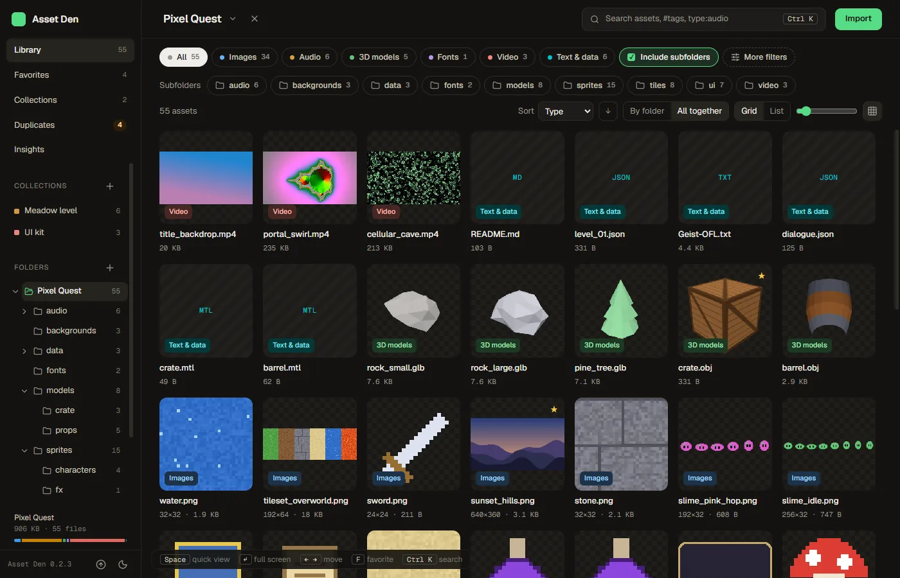
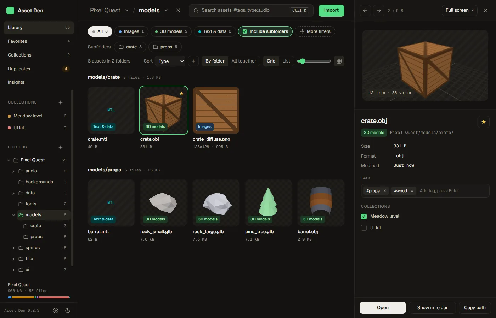
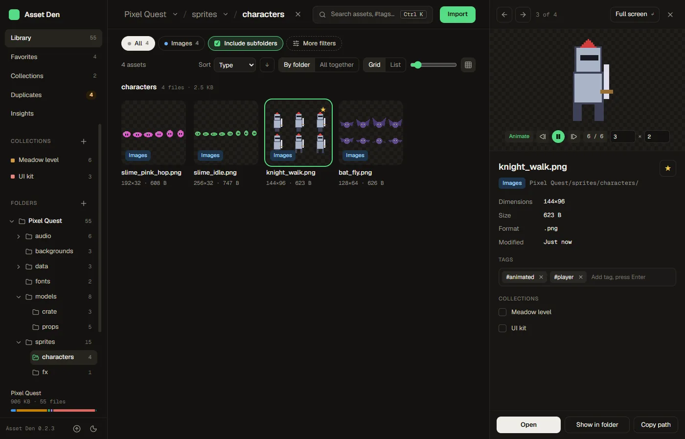
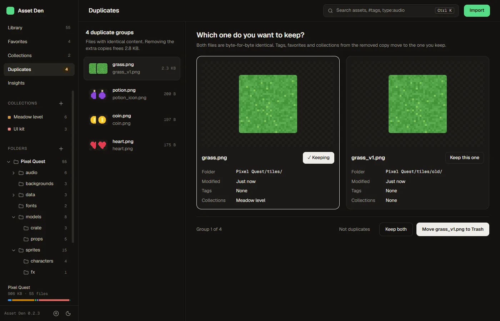
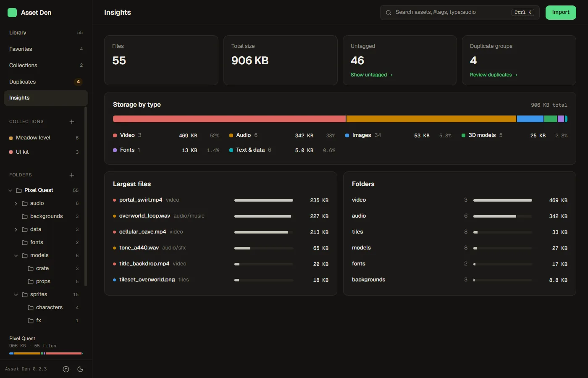
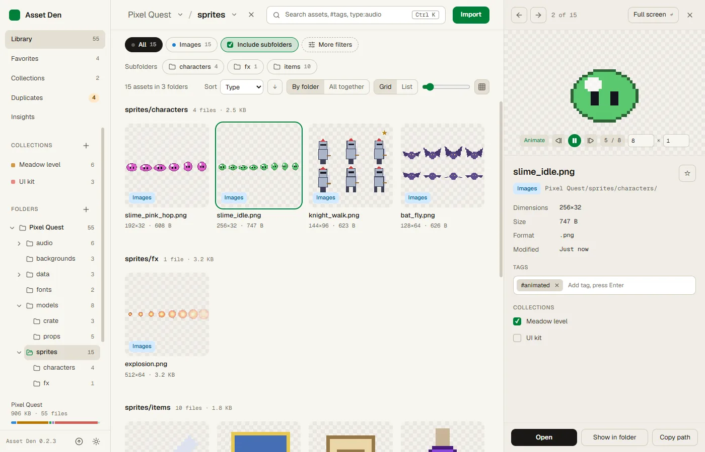

# Asset Den

A desktop asset browser for game developers on Windows, macOS and Linux. Point it at your asset folders and it
indexes every sprite, sound, model, font, video and data file so you can find, preview, tag and drag them into your
engine.



**Your files are left alone.** Tags, favorites and collections live in the app's own database, and removing a folder
from the library only forgets it. The one exception is on the Duplicates page: when you choose to, Asset Den moves the
extra copies of a file to your system's Trash (restorable there), after asking and after checking that they are still
byte-for-byte identical. "Copy to folder…" only ever creates new files.

## Features

- **Library**: import one or more folders. Assets appear while a folder is still scanning, and a live watcher picks up
  added, renamed and deleted files (renames keep their tags). Engine sidecars (`.meta`, `.import`, `.uid`), hidden
  folders and `node_modules` are skipped.
- **Folders**: an expandable folder tree in the sidebar with file counts, and a breadcrumb in the header whose carets
  jump to any subfolder or a recent folder. Subfolder chips drill down, <kbd>Alt+↑</kbd> goes to the parent, and
  **Include subfolders** switches between a folder's own files and everything below it.
- **Browse**: a grid or list grouped by folder (or all together), type chips, sorting and a thumbnail-size slider.
  **More filters** narrows by extension, image size, file size, date and tags.
- **Search** (<kbd>Ctrl/⌘ K</kbd> or <kbd>/</kbd>): one box for assets, folders and actions, with `type:audio`,
  `in:sprites`, `#player` and `size:>1mb`. Its first result applies the search to the grid.
- **Side panel** (<kbd>Space</kbd>) and **full screen** (<kbd>Enter</kbd>) previews:
  - images: zoom and pan, pixel-art scaling, transparency checkerboard (PNG, JPG, GIF, WebP, BMP, SVG, and
    TGA/PSD/TIFF via a decoded preview), and **Animate** to play a sprite sheet with a remembered grid and fps
  - audio: waveform and playback, plus play-on-hover in the grid
  - 3D models: orbit, wireframe, triangle counts, the first animation (GLB/glTF, FBX, OBJ, STL), with auto-rendered
    thumbnails. OBJ files load the materials and textures from their `.mtl`
  - fonts: a specimen with editable sample text
  - video, with a frame from the video as its grid thumbnail, and text
- **Organize**: tags, favorites and collections. Rename a collection in place, or copy its files into a folder for a
  build or a handoff. Most changes show a toast with **Undo**.
- **Drag out**: drag one card or a selection into Unity, Godot, Unreal, Blender or a folder. It always copies.
- **Duplicates**: identical files side by side. Keep the one you want, then mark the rest as not duplicates or move
  them to the Trash, with tags, favorites and collections merged into the kept file.
- **Insights**: totals, storage by type, the largest files and folders. Each row jumps to the matching assets.
- **Updates** (Windows): the app checks for a new version on launch and installs it in place. See [Updates](#updates).
- **Themes**: dark, light, or follow the system, from the sidebar footer.











The screenshots show a small sample library generated for them: procedural sprites, tiles, sounds, models and videos.

Keyboard: <kbd>Ctrl/⌘ K</kbd> or <kbd>/</kbd> search · <kbd>Space</kbd> side panel · <kbd>Enter</kbd> full screen ·
<kbd>←</kbd> <kbd>→</kbd> previous/next · <kbd>F</kbd> favorite · <kbd>Shift</kbd>/<kbd>Ctrl</kbd>-click and
<kbd>Ctrl+A</kbd> select · <kbd>Esc</kbd> step back.

## Install

Download the file for your OS from the
[latest release](https://github.com/sanchezrobertodev/asset-den-releases/releases/latest). From then on the app
updates itself (see [Updates](#updates)).

| OS | File | Notes |
|---|---|---|
| Windows | `AssetDen_<version>_x64-setup.exe` | Installs per user, without admin rights. The build isn't code-signed, so SmartScreen may warn: choose **More info → Run anyway**. |
| macOS | `AssetDen_<version>_universal.dmg` | Apple Silicon and Intel. Drag the app to Applications. It isn't signed with an Apple Developer ID or notarized, so Gatekeeper blocks the first launch: open **System Settings → Privacy & Security** and choose **Open Anyway** (or run `xattr -dr com.apple.quarantine "/Applications/Asset Den.app"`). Updates installed by the app don't ask again. |
| Linux | `AssetDen_<version>_amd64.AppImage` or `AssetDen_<version>_amd64.deb` | The AppImage runs anywhere (`chmod +x` it first) and updates itself. The `.deb` installs system-wide and doesn't update itself: install the next `.deb` by hand. Install the GStreamer plugins for MP4/H.264 video previews. |

### Build it yourself

Building needs Node 22+, Rust stable and the [Tauri prerequisites](https://tauri.app/start/prerequisites/) for your OS.

```bash
make install
make build
```

The installers land in `src-tauri/target/release/bundle/` (`nsis/` or `msi/` on Windows, `dmg/` on macOS,
`appimage/`, `deb/` or `rpm/` on Linux). A build without the signing key can't install updates from the feed.

## Updates

Installed copies check [asset-den-releases](https://github.com/sanchezrobertodev/asset-den-releases), a public repo
holding only installers and the update feed, quietly on launch, and whenever you press **Check for updates** in the
sidebar footer or the search palette. A new version shows its CHANGELOG notes, and **Install & restart** downloads it,
verifies its signature and relaunches.

Windows x64, macOS (both architectures) and the Linux AppImage update themselves. A `.deb` install, or a platform the
feed has no build for, hides **Check for updates**, so it never hits a missing-platform error. The first version with
the updater has to be installed by hand: 0.2.0 on Windows, and the first release with macOS and Linux builds there.

### Publishing a release

Every release carries all three OSes in one GitHub release and one `latest.json`. Windows is built and signed on a
Windows PC with `make release`; macOS and Linux are built by the **Release** workflow on GitHub Actions. Each merges its
entries into the release's `latest.json` instead of replacing it, so they can run in either order.

1. Bump the version in `src-tauri/tauri.conf.json`, `package.json` and `src-tauri/Cargo.toml`.
2. Move the Unreleased notes in `CHANGELOG.md` under `## [x.y.z] - date`. That section becomes the release notes and
   the in-app "What's new". Push the commit.
3. Run the **Release** workflow from the Actions tab on that branch, with the version (`x.y.z`), or
   `gh workflow run Release --ref master -f version=x.y.z`. It builds the universal macOS `.app` and `.dmg` and the
   Linux AppImage and `.deb`, signs the update bundles, and adds them to release `vx.y.z` in asset-den-releases,
   creating it as a draft if it doesn't exist yet.
4. Run `make release-dry` to build, sign and write `release/vx.y.z/` (installer, `latest.json`, notes) without
   uploading, then `make release` to upload the Windows installer, merge its feed entries and publish the release as
   latest.

Running the workflow first is the smooth order: the draft stays invisible to installed copies until `make release`
publishes it with every platform in the feed. If `make release` goes first, macOS and Linux copies get a "platform not
found" error from **Check for updates** (the launch check stays quiet) until the workflow finishes. Re-running either
replaces only its own files and feed entries. Don't run both at the same moment: the second could overwrite the
first's feed entries.

Updates are signed with `~/.tauri/asset-den.key`, created with `npx tauri signer generate`, whose public half is in
`tauri.conf.json`. **Back it up somewhere safe and never commit it:** installed copies only accept updates signed with
it, so losing it means users must reinstall by hand. `make build` signs too when the key is present, and otherwise
builds plain installers with a warning.

The workflow needs three repository secrets in asset-den (Settings → Secrets and variables → Actions):

| Secret | Value |
|---|---|
| `TAURI_SIGNING_PRIVATE_KEY` | The contents of `~/.tauri/asset-den.key` |
| `TAURI_SIGNING_PRIVATE_KEY_PASSWORD` | Its password. Skip it if the key has none: GitHub doesn't store empty secrets, and an unset one reads as empty. |
| `RELEASES_TOKEN` | A fine-grained personal access token limited to asset-den-releases, with **Contents: Read and write** |

## Develop

```bash
npm install
npm run tauri dev
```

Run `make check` before every push. It typechecks and bundles the frontend, then runs rustfmt, clippy (warnings are
errors) and the Rust tests. These local checks replace CI on push: the only GitHub workflow is **Release**, started by
hand to publish the macOS and Linux builds.

## Where things live

| What | Where |
|---|---|
| Index, tags, favorites, collections | `asset-den.db` (SQLite) in the app data folder |
| Thumbnails and decoded previews | `thumbs/` and `previews/` in the app cache folder (safe to delete) |
| UI preferences | browser storage in the app's webview |

## Known limits

- PSD previews use the flattened composite. Some layered or 16-bit files fall back to an icon.
- FBX textures with absolute paths from another machine won't load.
- Which audio and video formats play, and which videos get a frame thumbnail, depends on the OS webview. Windows
  (WebView2) plays the most; on Linux, install the GStreamer plugins for MP4/H.264.
- A file renamed while the app is closed shows up as a new file on the next scan, so its tags don't follow it.
- Syntax highlighting for text and code is not built yet.
- The visual design comes from the "Asset Den UI/UX redesign" project in Claude Design. The tokens live in
  `src/index.css`, and the rationale in `design-system/asset-den/MASTER.md`.

## License

[MIT](LICENSE)
